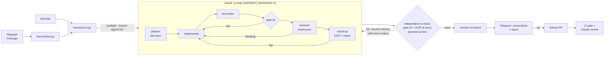

# Agentic harness

A change request goes in, from the terminal or from a Telegram message, and a
screenshot comes back on the phone **only after the change has been verified**.
The agents write the code. Deterministic scripts decide whether it is
done.



## Design principles

1. **The model never grades itself.** Every "done" is decided by code:
   `harness/gate.sh` (types, lint, tests, architecture, secrets) and
   OCR on real simulator screenshots. `harness/run.py` re-runs both after the
   agent says it has finished, and only that result counts.
2. **Plans are contracts.** The planner must emit machine-checkable
   criteria: which screens change and the exact strings that must appear on
   them (`expect_text`). The harness feeds those strings to the OCR. A plan
   that promises text the app doesn't render fails the run.
3. **Feedback is the raw failure, not a summary.** On a failed check the
   same agent session is resumed with the exact compiler, lint, test or OCR
   output. The fix loop is capped at 3 iterations inside `/ship` and
   `--retries` (default 2) at the harness level.
4. **Guardrails live in hooks, not prompts.** Prompts are advice; hooks are
   enforced by the runtime (`.claude/hooks/`):
   | hook | event | what it enforces |
   | --- | --- | --- |
   | `guard.py` | PreToolUse | no credential reads, no raw Telegram API, no destructive git; in unattended runs no git at all and **no edits to `.claude/`, `harness/`, `scripts/`** (the agent cannot weaken its own judges) |
   | `lint_changed.py` | PostToolUse | ESLint + architecture check on every TS edit, fed back in the same turn |
   | `stop_gate.py` | Stop | the agent cannot end its turn while the gate is red (fingerprint-cached, max 3 blocks) |
5. **Least privilege per agent.** Planner and reviewer are read-only, and
   visual-qa can only run Bash and read images. Models are matched to the job:
   Opus for planning and review, Sonnet for tests and visual QA.
6. **Isolation and audit.** Each run happens on `agent/<run-id>` from a
   clean tree. Everything it produced (plan, gate reports, review, visual
   verdict, screenshots, raw agent JSON with cost and turns, event log) lives in
   `.harness/runs/<run-id>/`.
7. **Untrusted input is quoted.** The bot only accepts the owner's private
   chat, drops the backlog on start-up, and shell-quotes agent-written text
   (PR titles) before it reaches bash.

## Components

| path | role |
| --- | --- |
| `.claude/agents/planner.md` | request → `plan.json` (layers, files, screens, `expect_text`, acceptance, tests) |
| `.claude/agents/implementer.md` | applies the plan; knows the Clean Architecture rules |
| `.claude/agents/test-writer.md` | Jest tests for logic changes, no network |
| `.claude/agents/reviewer.md` | independent diff review → `review.json` verdict |
| `.claude/agents/visual-qa.md` | captures with OCR, then inspects the PNG with vision → `visual.json` |
| `.claude/skills/ship/SKILL.md` | `/ship` orchestrator: stages, fix loop, delivery |
| `.claude/settings.json` | permission allowlist for headless runs + hook wiring |
| `harness/gate.sh` | deterministic gate, JSON report; `--changed` (quick level) and `--scope` while iterating |
| `harness/scope.py` + `scope.json` | what a diff touches (screens, shared code with its why) → `quick` or `full` |
| `harness/retro.py` + `.claude/hooks/record_command.py` | repeated ad-hoc commands across sessions → candidates for a script ([agent-design.md](./agent-design.md)) |
| `harness/check_architecture.py` | dependency rule between `src/` layers |
| `harness/preflight.sh` | simulator, app, Metro (starts it), credentials |
| `harness/run.py` | headless runner: isolate → agent → re-verify → fix loop → commit → Telegram |
| `harness/bot.py` | Telegram front-end (`/ship`, `/continue`, `/status`, `/gate`, `/screen`, `/pr`, `/cancel`) |
| `harness/eval.py` + `harness/evals/` | agent-level and system evals, roster-aware `compare`, baselines ([evals.md](./evals.md)) |
| `harness/agents.py` | roster fingerprint, opencode sync, eval-coverage check |
| `harness/backends.py` + `backends.json` | Claude Code or opencode + Ollama behind one interface, plus per-agent routes for the hybrid backend ([local-backend.md](./local-backend.md), [hybrid.md](./hybrid.md)) |
| `harness/pipeline.py` + `pipeline.json` | deterministic orchestrator; the stage list is shared with `/ship` |
| `.opencode/` | generated agents + plugin that runs the same hooks under opencode |
| `scripts/telegram.sh` | capture + OCR (`--expect`) + send; `--text` for reports |
| `.github/workflows/ci.yml` | the same gate on every push/PR |
| `.github/workflows/claude-review.yml` | the `reviewer` agent on every PR |

## Usage

```sh
# interactive, inside Claude Code
/ship make the hero name on Superstar gold

# unattended, from the terminal
harness/run.py "make the hero name on Superstar gold"
harness/run.py --no-visual "add a test for HeroMapper with null roles"

# from the phone
harness/bot.py        # then message the bot: "make the hero name gold"

# fully local (opencode + Ollama + Qwen)
harness/run.py --backend opencode "make the hero name gold"

# hybrid: a route per agent, picked by harness/eval.py matrix
harness/run.py --backend hybrid "make the hero name gold"

# evals
harness/eval.py agents && harness/eval.py compare
```

Requirements: Claude Code CLI logged in, booted iOS simulator with the app
installed (`yarn ios`), Telegram credentials (see [telegram.md](./telegram.md)).
`run.py` needs a clean working tree: it refuses to mix its changes with yours.

## What a run sends to Telegram

```
✅ Make the Superstar hero name gold
run: 20261027-231502-make-the-hero-name-on-superstar-gold
branch: agent/20261027-231502-make-the-hero-name-on-superstar-gold
checks: types ✓ · lint ✓ · tests ✓ · architecture ✓ · secrets ✓ · OCR ✓ · review ✓ · visual-qa ✓
agent: 38 turns · 6.4 min · $1.12 · 0 fix iteration(s)
files: src/presentation/screens/SuperstarScreen.tsx, src/presentation/theme/colors.ts
Reply /pr to open a pull request, /continue <request> to iterate.
```

preceded by one verified screenshot per changed screen.

## Failure modes it catches

These are real ones, not hypothetical:

- **Metro down → red box.** The simulator shows "No script URL provided". OCR
  doesn't find the screen title, so nothing is sent. Preflight now starts
  Metro, and the capture cold-restarts the app because Fast Refresh can't
  recover from a red box.
- **Forbidden import.** `axios` in a screen or `react-native` in a use case is
  rejected on the edit itself (PostToolUse) and again by the gate.
- **"Done" while tests fail.** The Stop hook blocks the turn, and the harness
  re-runs the gate anyway.
- **Agent tries to relax the gate.** Edits to `harness/`, `scripts/` or `.claude/`
  are blocked during unattended runs.
