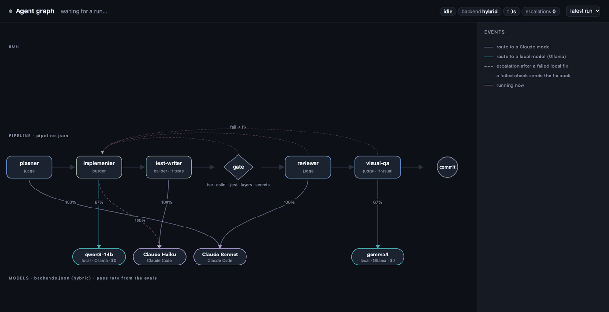
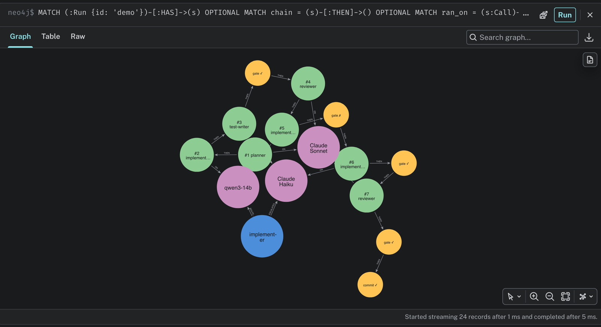

# The agent system as a live graph (Neo4j + Cypher)

The agents, the pipeline, the model each one is routed to and every run are
loaded into Neo4j, and a small viewer redraws the graph while the agents work:
which agent is running, on which model, which check went red, when the
harness escalated.



*A recorded hybrid run, 51 minutes replayed in about 25 seconds. The reviewer blocks the first
change, qwen3 14B (local) times out on the fix, the gate goes red, the
harness escalates the fix to Claude Haiku (30 s) and the run is committed.
Pass rates on the route edges come from the evals.*

## Run it

```sh
harness/graph.py up        # Neo4j 5 Community in Docker, bound to 127.0.0.1
harness/graph.py serve     # load the structure, follow runs live: http://localhost:7475

harness/run.py "<request>" --backend hybrid   # in another terminal: watch it live
harness/graph.py replay                       # or replay the bundled demo run
```

Neo4j Browser is at http://localhost:7474 (no auth: the container only
listens on loopback; APOC is installed for the MCP server). Example queries are in
[`harness/viewer/queries.cypher`](../harness/viewer/queries.cypher).
`harness/graph.py export` prints the structure as Cypher for any other Neo4j.

## The model

```
(:Stage)-[:NEXT]->(:Stage)            pipeline.json, in order
(:Stage)-[:RUNS]->(:Agent)            planner, implementer, … ; gate and commit run no agent
(:Stage)-[:ON_FAIL]->(:Stage)         gate, reviewer, visual-qa send the fix back to the implementer
(:Agent)-[:CAN_USE]->(:Tool)          frontmatter tools; Agent.role = judge | builder
(:Agent)-[:ROUTED_TO {backend}]->(:Model)      backends.json, per backend
(:Agent)-[:ESCALATES_TO {backend}]->(:Model)   the hybrid's escalation route
(:Agent)-[:SCORED {pass_rate, runs, seconds, cost_usd}]->(:Model)   eval.py matrix

(:Run)-[:HAS]->(:Call | :Check)       one node per agent call and per gate/OCR/commit
(:Call)-[:THEN]->(:Check)-[:THEN]->(:Call)      the run in order
(:Call)-[:OF]->(:Agent), (:Call)-[:ON]->(:Model)
```

`Call` carries `status` (running, done, error), `seconds`, `turns`, `error`,
`escalated` and the reviewer's `verdict`; `Run` carries `status`, `backend`,
`request`, `escalations`, `cost` and the last events.



## Questions it answers

```cypher
// Design rule: a judge must never have a write tool.
MATCH (a:Agent {role: 'judge'})-[:CAN_USE]->(t:Tool)
WHERE t.name IN ['Edit', 'Write'] RETURN a.name, t.name;

// Escalations: which local call got stuck and what took over.
MATCH (stuck:Call)-[:THEN*1..2]->(fix:Call {escalated: true})
RETURN stuck.label, stuck.error, fix.label, fix.seconds;
// → qwen3-14b · "timed out after 45 min" · Claude Haiku · 30

// Where the time goes, per model, across every run.
MATCH (c:Call)-[:ON]->(m:Model)
RETURN m.label, count(c) AS calls, sum(c.seconds) AS seconds ORDER BY seconds DESC;
```

## Ask it in plain language (Neo4j MCP)

`.mcp.json` registers Neo4j's official MCP server
([`mcp-neo4j-cypher`](https://github.com/neo4j-contrib/mcp-neo4j) 0.6.0, the
Docker MCP catalog image pinned by digest) in **read-only** mode: it exposes
`get_neo4j_schema` and `read_neo4j_cypher`, and refuses anything that isn't a
read. Open Claude Code in the repo, approve the `neo4j` server, and ask about
the agents. The model reads the schema, writes the Cypher and answers from
the data.

Three real questions, asked headless with Sonnet through Claude Code
(`claude -p … --mcp-config .mcp.json`, graph tools only). Each took 10–15 s and
one or two queries:

> **In the most recent run, which agent call got stuck, on which model, and
> what rescued it? How long did each take?**

```cypher
MATCH (r:Run) WITH r ORDER BY r.t DESC LIMIT 1
MATCH (r)-[:HAS]->(c:Call) OPTIONAL MATCH (c)-[:ON]->(m:Model)
RETURN r.id, r.status, r.escalations, c.seq, c.agent, c.status, c.verdict, c.error,
       c.escalated, c.local, c.route, c.model, m.name, c.seconds, c.turns, c.t, c.end
ORDER BY c.seq
```

> The **implementer** call got stuck: it ran on the local
> `qwen3-14b-agent` and timed out after 45 minutes with 0 turns. Escalation to
> Claude **Haiku** rescued it in 30 s (6 turns). The fix followed the
> reviewer's first `fail` verdict; the reviewer (Sonnet) then passed the
> escalated fix in 11 s. The local implementer's first attempt had taken
> 237 s over 4 turns.

> **Which agents in the hybrid backend run on a model that scored below 100%
> in the evals, and which of them have an escalation route?**

```cypher
MATCH (a:Agent)-[r:ROUTED_TO {backend:'hybrid'}]->(m:Model)
OPTIONAL MATCH (a)-[s:SCORED]->(m)
OPTIONAL MATCH (a)-[e:ESCALATES_TO {backend:'hybrid'}]->(em:Model)
RETURN a.name, m.name, s.pass_rate, s.runs, em.name AS escalates_to
```

> Two: `implementer` (qwen3-14b, 66.7%, escalates to Haiku) and `visual-qa`
> (gemma4, 66.7%, no escalation). Planner, reviewer and test-writer score 100%
> on their models.

> **If I ran everything on local models, which agent would be the weakest
> link, and what would the hybrid use instead?**

> **test-writer**: 0% on qwen3 (0/2), and no local model above 50%; the hybrid
> routes it to Claude Haiku (2/2). Next, the reviewer: 50% on qwen3 locally,
> Sonnet in the hybrid.

These match [benchmarks.md](./benchmarks.md) (findings 3 and 5), and the
answer to the second question points at a real gap: visual-qa is the only
sub-100% route with no escalation, backed by OCR rather than a stronger
model.

## Design

- **Derived, never edited.** The structure comes from `.claude/agents/`,
  `pipeline.json`, `backends.json` and the eval results; runs come from the
  `events.jsonl` that `run.py` already writes. The database has no volume,
  and every load is safe to repeat (`MERGE`). One definition per thing: the
  graph can't drift from the agents it describes.
- **Decoupled from the run.** `serve` tails `.harness/runs/*/events.jsonl`
  (a half-written line waits for the next tick). `run.py` doesn't know Neo4j
  exists; if the graph is down, runs are unaffected.
- **No new dependencies.** The harness talks to Neo4j's HTTP API with the
  Python standard library; the viewer is one HTML file with hand-drawn SVG
  and no libraries. It polls `/api/graph` (three Cypher queries) every 0.6 s.
- **Tested offline.** `harness/evals/selftest.py` replays the demo run into
  statements without Neo4j and checks the chain (7 calls, 5 checks, the
  escalated call on Haiku).

Limits: with the plain `claude` backend `/ship` orchestrates inside one Claude
session, so the graph shows that session as a single `/ship` call; the hybrid
and local backends (and any `--route`) run each agent as its own call. The
demo run is a real one from the system evals (2026-10-28), with its start,
end and the reviewer's verdicts added from the run's own summary and
iteration log, since those events didn't exist yet.
