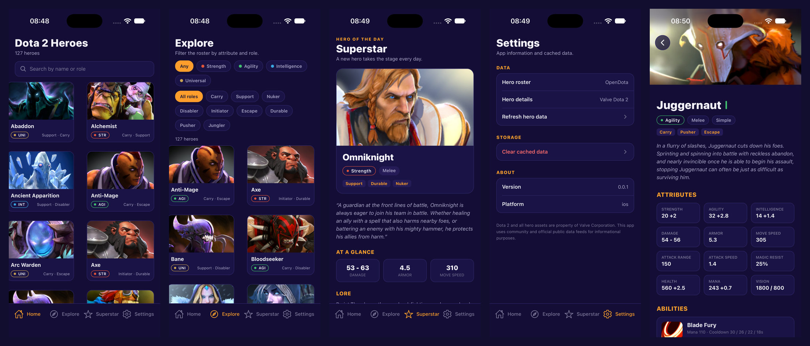

# React Native 0.87.1 → 0.88.1, done by the agents

The upgrade was one request to the unattended pipeline
(`harness/run.py --backend claude --orchestrator harness`). The agents wrote
every change to the app. A person fixed the harness between attempts, never
the app. It took five runs: the first four failed on gaps in the harness, not
on the agents' code, and each failure became a commit to the harness.



## The request

> Upgrade React Native from 0.87.1 to 0.88.1 following
> [react-native-0.87.1-to-0.88.1.template.diff](./react-native-0.87.1-to-0.88.1.template.diff)
> (the template app RnDiffApp is dota2App here): bump react, react-native,
> @react-native/\* and react-test-renderer in package.json, adopt the 0.88
> SceneDelegate/AppDelegate/Info.plist changes keeping the module name
> dota2App and a readable status bar on the dark theme, and update the React
> Native version in the readme tech stack (not in docs/benchmarks.md or the
> OpenClaw docs, which record what was measured then). Do not run package
> managers yourself: the harness installs the dependencies before each gate
> and runs pod install plus an iOS rebuild before the screenshots, and sends
> you their output if they fail. Every screen must still render.

The template diff comes from
[rn-diff-purge](https://github.com/react-native-community/rn-diff-purge). A
person committed it beforehand, so the agents worked from a pinned file rather
than from the web.

## What the agents changed

| File | Change |
| --- | --- |
| `package.json` | react and react-test-renderer 19.2.3 → 19.3.0. react-native and the five `@react-native/*` dev packages 0.87.1 → 0.88.1. Nothing else. |
| `ios/dota2App/AppDelegate.swift` | Now just `import UIKit` and a `didFinishLaunching` that returns `true`. The React Native factory moved out. |
| `ios/dota2App/SceneDelegate.swift` | Subclasses `RCTDefaultReactNativeFactoryDelegate` and owns the factory. Starts with `startReactNative(withModuleName: "dota2App", in:, connectionOptions:)`. Adds the DEBUG `RCTDevMenuConfiguration`, the `RCTLinkingManager` scene handlers for URLs and user activities, and the `bundleURL()` override. |
| `ios/dota2App/Info.plist` | `UIViewControllerBasedStatusBarAppearance` → `true` (template). `UIUserInterfaceStyle` → `Dark`, so the status bar stays light on the dark theme. |
| `readme.md` | Tech stack line says 0.88. Benchmarks and OpenClaw docs still say 0.87 on purpose. |
| `yarn.lock`, `ios/Podfile.lock` | Regenerated by the harness (`scripts/deps_install.sh`, `scripts/ios_build.sh`), not by an agent. |

The planner chose the status bar approach and recorded why. React Native's
`<StatusBar>` raises a red box in DEBUG once appearance is view-controller
based, and `UIUserInterfaceStyle=Dark` needs no JavaScript. It listed the
trade-off as a risk: native alerts are dark too. It also expected
`project.pbxproj` to stay untouched (SceneDelegate.swift was already in the
target), and it did.

## The passing run

Run `20261030-084211`, 8.1 min wall clock, no fix rounds:

| t | Stage | Result |
| --- | --- | --- |
| 0:00 | planner (Opus) | Plan: 17 acceptance criteria, 7 risks, the five screens and their OCR strings ([plan](#the-plan-in-short)) |
| 1:12 | implementer | Applied the template, 15 turns |
| 2:01 | test-writer | No new tests: there is no domain or hook logic to test. The existing `App.test.tsx` covers the render. |
| 2:19 | install | `yarn install` on 0.88.1 by the harness ✓ |
| 2:22 | gate | types, lint, tests, architecture, agents, secrets ✓ |
| 2:59 | build | `pod install`, `pod update` of two prebuilt pods, `xcodebuild`, install on the simulator ✓ (37 s) |
| 3:26 | reviewer (Opus) | **pass**, with notes to check the safe-area insets and the bundle URL in the screenshots |
| 5:45 | visual-qa | **pass**: all five screens render, with no red box and a light status bar |
| 8:06 | final OCR | home, explore, superstar, settings and detail ✓, then commit |

Replay it in the live viewer:

```sh
harness/graph.py replay docs/migrations/react-native-0.88.events.jsonl
```

## The four failed runs, and the harness fix each one led to

| Run | What happened | Fix |
| --- | --- | --- |
| 1 `20261029-190425` | Unattended agents may not run package managers, because install scripts execute arbitrary code. `yarn.lock` stayed at 0.87.1 and the gate tested the old packages. The reviewer blocked four rounds in a row. The implementer refused to widen its own permissions and said a person had to decide. | `c768e04`: the harness installs dependencies itself (`scripts/deps_install.sh`) before every gate when `package.json` or `yarn.lock` changed. |
| 2 `20261029-191331` | Install ✓ and gate ✓, then the run hit quota before review. The harness kept retrying the reviewer. | `412deda`: stop the run on quota instead of retrying. |
| 3 `20261030-081730` | The reviewer passed the code on its first look. Then `pod install` refused the changed `React-Core-prebuilt` podspec. The build only ran after review, so it never ran again, and the reviewer blocked three more rounds on a build nobody retried. The fixer saw only the last clang command line, not the error. | `21ff711`: the build runs right after the gate, on every round. The fixer receives the `error:` and CocoaPods `[!]` lines. `ios_build.sh` runs the `pod update` that CocoaPods names. |
| 4 `20261030-082906` | CocoaPods names one pod per attempt (`ReactNativeDependencies`, then `React-Core-prebuilt`), so the single retry still failed. Every fix round went to a problem the implementer could not touch. | `b3deec0`: repeat `pod update` until CocoaPods names no more pods. |

All four are the same kind of gap. The pipeline had only handled JavaScript
and UI changes, and a version upgrade is the first change that needs the
package managers and a new native binary. The agents' code changed little from
run to run: from run 2 on, `package.json` and both delegates were essentially
the same diff. Both guardrails worked as intended. The implementer did not get
around the package-manager rule, and the reviewer never passed a change the
build had not proven.

## What it cost

Every run records its usage in `.harness/runs/<id>/summary.json`. Tokens below
are input + output + cache reads, as Claude Code reports them. The dollar
figure is the API-equivalent price Claude Code reports. It ran on a Claude
Code subscription, not a pay-per-call key.

| Run | Status | Agent calls | Turns | Tokens | of which output | Agent time | API-equivalent |
| --- | --- | --- | --- | --- | --- | --- | --- |
| 1 | fail | 12 | 91 | 948,484 | 34,991 | 6.5 min | $2.09 |
| 2 | fail (quota) | 5 | 39 | 278,836 | 10,941 | 1.8 min | $0.61 |
| 3 | fail | 12 | 108 | 1,452,966 | 41,034 | 6.8 min | $2.75 |
| 4 | fail | 8 | 110 | 1,451,005 | 43,487 | 7.3 min | $2.27 |
| 5 | **pass** | 5 | 52 | 463,358 | 18,385 | 4.7 min | $0.98 |
| **Total** | | 42 | 400 | **4,594,649** | 148,838 | 27.1 min | **$8.70** |

Of the input, 4.45 M tokens were cache reads (re-reading the repository and
the plan) and 649 k were cache writes. Fresh output was 149 k tokens. The
upgrade itself, once the harness could handle native changes, was $0.98 and
463 k tokens. The other 89% went to finding and fixing the four harness gaps.
That is the cost of the first native change through this pipeline, and future
upgrades should not pay it again.

## The plan in short

The planner's acceptance criteria, which the reviewer and visual-qa checked
against:

- `package.json` has exactly the versions above, no other changes, and no
  `0.87.1` or `19.2.3` left.
- AppDelegate and SceneDelegate match the 0.88 template. The module name is
  `dota2App`, and `RnDiffApp` appears nowhere.
- SceneDelegate no longer reaches into `UIApplication.shared.delegate` or
  builds `launchOptions` by hand.
- Info.plist sets view-controller based status bar appearance and a dark
  interface style. The scene manifest and fonts stay.
- No `<StatusBar>` component, no change under `src/` or to `App.tsx`, and no
  change to `project.pbxproj`.
- After install, pod install and the rebuild, all five screens render their
  OCR strings with no red box or LogBox.

The risks it listed ahead of time: dark native alerts, the dropped
`appDelegate.window` (watch safe-area insets), the dropped
`sourceURL(for:)` (watch for a blank bundle), third-party native libraries
needing new versions, and new lint rules. None of them showed up in the
build or the screenshots.
