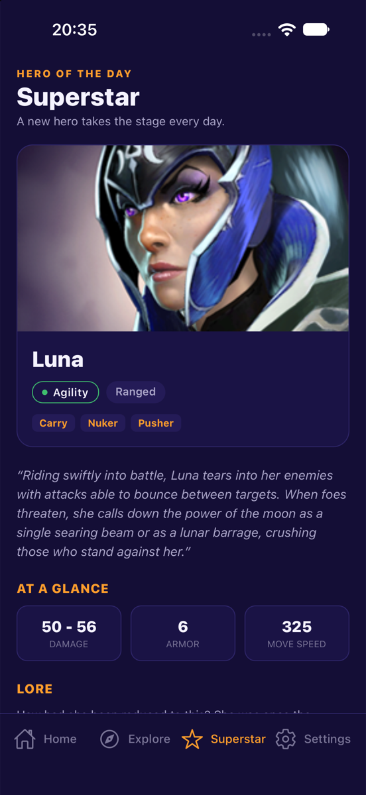
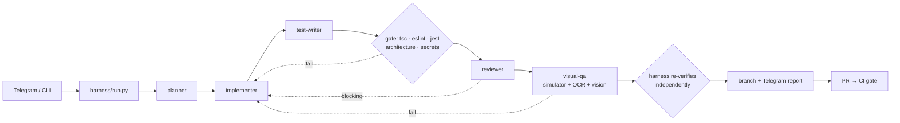

# Dota 2 App

[](https://github.com/kevingo710/dota2App/actions/workflows/ci.yml)

React Native app that lists the 127 Dota 2 heroes from the [OpenDota API](https://docs.opendota.com/) and shows a full hero profile (stats, attributes and abilities) from Valve's Dota 2 data.

## Screens

- **Home** — searchable roster in a two-column grid
- **Explore** — same roster filtered by primary attribute and role
- **Superstar** — hero of the day with stats, hype quote and lore
- **Hero detail** — attributes, combat stats and abilities with icons
- **Settings** — data sources, cache controls and app info

## Screenshots

Captured on the iPhone 18 Pro simulator (iOS 27). Regenerate them with
`scripts/screenshots.sh` (booted simulator + `yarn ios`); the process is
documented in [docs/screenshots.md](./docs/screenshots.md).

<p>
  
  
  
</p>
<p>
  
  
</p>

## Built by an agent team

Changes to this app are made by a team of AI agents and **validated by
deterministic checks before a human sees them**. A message to a Telegram bot
("make the hero name gold") comes back as verified screenshots of the running
app on an isolated branch, ready for `/pr`.



### Results

Measured with the repo's own evals ([docs/benchmarks.md](./docs/benchmarks.md)):

| | pass | cost | time |
| --- | --- | --- | --- |
| Agents on Claude Opus/Sonnet | 16/16 | $1.72 | 42 s/case |
| Agents on Claude Sonnet/Haiku | 16/16 | **$0.43** | 35 s/case |
| Agents fully local (qwen3 8B + gemma4, M4 Pro) | 9/16 | $0 | 164 s/case |
| End to end, Claude | 4/4 tasks | $3.71 | 2.4 min/task |
| End to end, **hybrid** (Claude judges, local builds, escalation) | 4/4 tasks | **$0.49** | 23 min/task |

### Watch it live

The agents, their routes and every run live in **Neo4j**; `harness/graph.py
serve` redraws the graph while the agents work. Here a real hybrid run
(51 min, replayed): the reviewer blocks the first change, the local
implementer times out, the gate goes red, the fix **escalates to Claude
Haiku** and the run passes ([docs/graph.md](./docs/graph.md)).


The same run in Neo4j Browser: each call linked to the next (`THEN`) and to
the model it ran on (`ON`); the implementer's route to qwen3-14b and its
escalation to Claude Haiku:


And you can ask it in plain language: `.mcp.json` plugs Neo4j's official MCP
server (read-only) into Claude Code, which writes the Cypher itself:

> **Which agents in the hybrid backend run on a model that scored below 100%
> in the evals, and which of them have an escalation route?**
>
> Two: `implementer` (qwen3-14b, 66.7%, escalates to Haiku) and `visual-qa`
> (gemma4, 66.7%, no escalation). Planner, reviewer and test-writer score 100%.
>
> <sub>`MATCH (a:Agent)-[r:ROUTED_TO {backend:'hybrid'}]->(m:Model) OPTIONAL MATCH (a)-[s:SCORED]->(m) OPTIONAL MATCH (a)-[e:ESCALATES_TO {backend:'hybrid'}]->(em:Model) RETURN …` · Sonnet, 12 s</sub>

### How it works

- **5 single-purpose agents** (`.claude/agents/`): judges are read-only and
  builders can't edit the harness that judges them. The gate enforces both.
- **Code decides "done", not the model.** `harness/gate.sh` (types, lint,
  tests, Clean Architecture layers, secret scan) plus OCR on real simulator
  captures, re-run by the harness after the agent says it's finished.
- **Plans as contracts.** The planner declares the screens, the exact
  on-screen text and how much to verify. The harness checks all three.
- **Self-correcting loop.** The raw failure goes back to the agent, with capped
  retries and **escalation** to a stronger model when a cheap one gets stuck.
- **Measured per agent and as a system.** Deterministic graders including
  **mutation testing**, a roster fingerprint on every result, and `compare`
  showing what an added or changed agent bought and cost
  ([docs/evals.md](./docs/evals.md)).
- **Three backends, one definition.** Claude Code, fully local (opencode +
  Ollama) or **hybrid**, with a route per agent picked by
  `harness/eval.py matrix` ([docs/hybrid.md](./docs/hybrid.md),
  [docs/local-backend.md](./docs/local-backend.md)).

### Guardrails

- Credentials never enter the repo or an agent's context: they're loaded by
  `scripts/telegram.sh` from outside the repo, and `.claude/hooks/guard.py`
  blocks any tool call that reads them or calls the Telegram API by hand.
- No destructive git, no skipping git hooks, and no git at all in unattended
  runs: the harness commits on an isolated `agent/<run-id>` branch.
- Per-agent least privilege, rendered for both backends and tested
  (`harness/local/guardrails_test.py`).
- The bot only answers its owner's private chat, drops the backlog on start-up
  and shell-quotes anything an agent wrote. Captions are sent with
  `--form-string`, so agent text can't make curl read a local file.
- CI runs the same gate with a read-only token and no AI in the loop: no
  repository secrets, no paid API. Agents run on Claude Code or on local
  models, never through a pay-per-call API key.

### Docs

| | |
| --- | --- |
| [agentic-harness.md](./docs/agentic-harness.md) | Architecture, principles, components, failure modes caught |
| [agent-design.md](./docs/agent-design.md) | DRY, KISS, SoC/SRP, YAGNI and SOLID applied to agents, and which ones the gate enforces |
| [evals.md](./docs/evals.md) | How agents and the system are measured, roster tracking, `compare` |
| [hybrid.md](./docs/hybrid.md) | Per-agent routes, tolerance, escalation, local model candidates |
| [benchmarks.md](./docs/benchmarks.md) | All the numbers, the findings and the harness bugs the evals found |
| [local-backend.md](./docs/local-backend.md) | opencode + Ollama, shared guardrails |
| [graph.md](./docs/graph.md) | The agent system in Neo4j: live viewer, graph model, Cypher queries, MCP demo |
| [openclaw-telegram-flow.blog.md](./docs/openclaw-telegram-flow.blog.md) | The first version of the loop, on OpenClaw, and what broke |

## Tech stack

- React Native 0.87 (New Architecture), React 19, TypeScript
- React Navigation 7 (bottom tabs + native stack)
- [TanStack Query](https://tanstack.com/query/latest) for server state
- [InversifyJS](https://inversify.io) + `reflect-metadata` for dependency injection
- [LegendList](https://legendapp.com/open-source/list/) for the heroes lists
- Ionicons (`@react-native-vector-icons/ionicons`), Axios, Jest, ESLint, Prettier

Hero and ability images are loaded from Valve's Steam CDN (`cdn.cloudflare.steamstatic.com`).

## Getting started

Requirements: Node >= 22.11, Yarn 1, JDK 17 + Android SDK (Android), Xcode + CocoaPods (iOS, macOS only).

```sh
yarn install
cp .env.example .env   # placeholders only; no secrets live in the repo

# iOS
cd ios && bundle install && bundle exec pod install && cd ..
yarn ios

# Android
yarn android
```

`yarn start` runs Metro on its own if you launch the app from Android Studio / Xcode.

## Scripts

| Command | Description |
| --- | --- |
| `yarn start` | Start Metro |
| `yarn android` / `yarn ios` | Build and run on an emulator/simulator or device |
| `yarn test` | Run Jest |
| `yarn lint` | Run ESLint |
| `npx tsc --noEmit` | Type-check |
| `scripts/screenshots.sh` | Recapture the README screenshots on the iOS simulator |
| `scripts/telegram.sh` | Capture a screen and send it to Telegram (see [docs/telegram.md](./docs/telegram.md)) |
| `harness/gate.sh` | Quality gate: types, lint, tests, architecture, agents, secrets (`--changed` while iterating) |
| `harness/run.py "<request>"` | Unattended agent run → verified screenshots on Telegram |
| `harness/bot.py` | Telegram bot that drives `harness/run.py` from the phone |
| `harness/eval.py agents\|system\|compare` | Evaluate each agent / the whole system, compare against the baseline |
| `harness/run.py --backend opencode` | Same pipeline on local models (opencode + Ollama) |
| `harness/run.py --backend hybrid` | A route per agent: Claude where it decides the result, local where a check backs it up |
| `harness/eval.py matrix` | Pass rate and cost per agent × model, and the suggested hybrid routes |
| `harness/retro.py` | Repeated ad-hoc commands that should become a script |
| `harness/graph.py up\|serve\|replay` | Agents and runs in Neo4j, live viewer on `localhost:7475` |

## Architecture

Clean Architecture with an InversifyJS container (`reflect-metadata` + legacy decorators via Babel):

```
src/
  domain/          entities, repository interfaces, use cases (no framework imports)
  data/            DTOs, mappers, data sources, repository implementations
  infrastructure/  HttpClient (axios)
  core/di/         TYPES tokens, ContainerModules, container, DIProvider/useInjection
  core/query/      TanStack Query client (refetch when the app returns to foreground)
  presentation/    screens (Home, Explore, Superstar, Settings, HeroDetail), navigation, components, hooks, theme
```

Dependencies point inwards: `presentation -> domain <- data -> infrastructure`.

```
HomeScreen -> useHeroes -> useQuery -> GetHeroesUseCase -> HeroRepository -> HeroRemoteDataSource -> HttpClient
HeroDetailScreen -> useHeroDetails -> GetHeroDetailsUseCase -> ...
```

Bindings live in `src/core/di/modules.ts`. Components resolve use cases with `useInjection(TYPES.X)` and call them from TanStack Query hooks; tests can `container.rebind(...)` any dependency with a fake.

### Adding a feature

1. Add the entity, repository interface and use case in `src/domain`.
2. Implement the data source / repository in `src/data` (map API DTOs to entities in `src/data/mappers`).
3. Add tokens in `src/core/di/types.ts` and bind them in `src/core/di/modules.ts`.
4. Expose it to screens through a hook in `src/presentation/hooks` using `useQuery` / `useMutation`.

## Tips

Remove the window shadow from macOS screenshots:

```sh
defaults write com.apple.screencapture disable-shadow -bool TRUE; killall SystemUIServer
```
