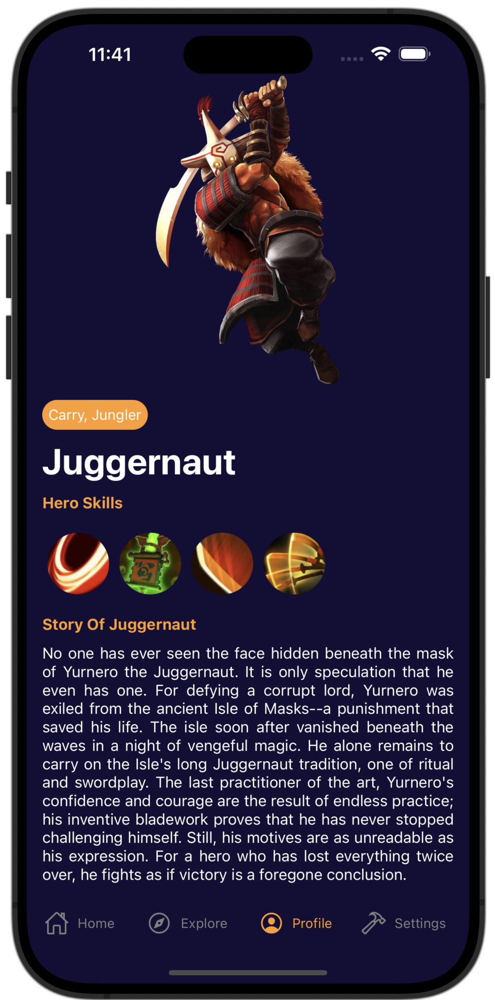
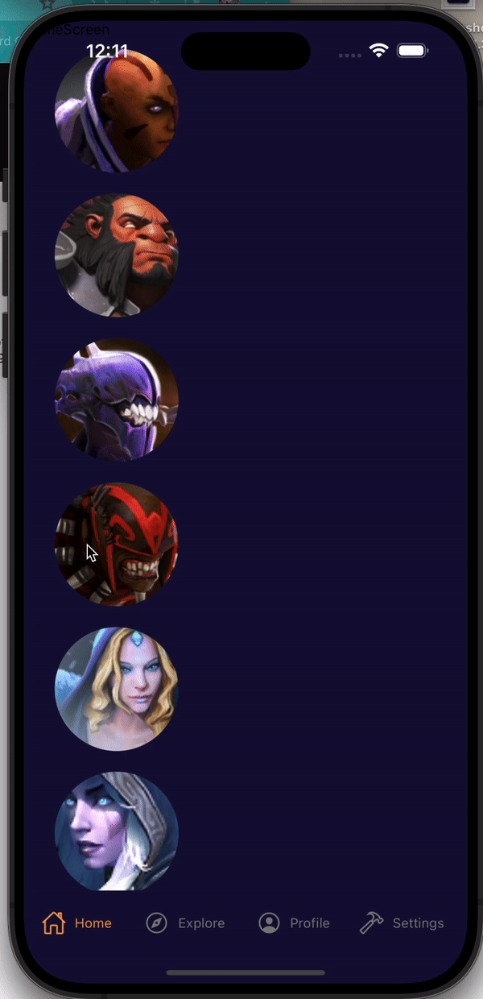

## Screenshots

<div style="display: flex; flex-direction: 'row';">

</div>

## Demo

<div style="display: flex; flex-direction: 'row';">


</div>


## To run this app

Requirements: Node >= 22.11, Yarn 1, JDK 17 (Android), Xcode + CocoaPods (iOS).

```sh
yarn install
cd ios && bundle install && bundle exec pod install && cd ..
yarn ios      # or: yarn android
```

### Better screenshots remove shadow

´defaults write com.apple.screencapture disable-shadow -bool TRUE; killall SystemUIServer´ 