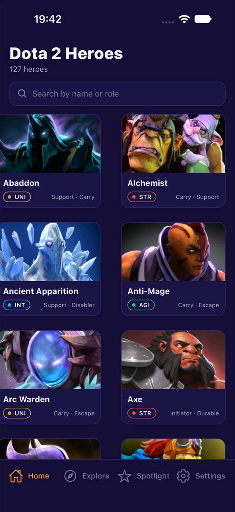
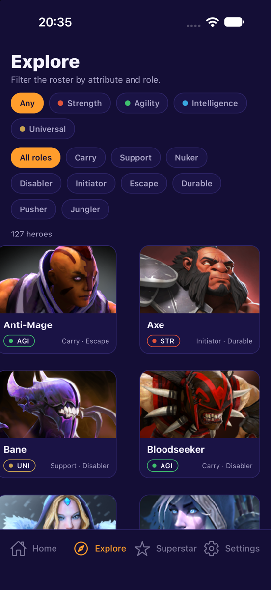
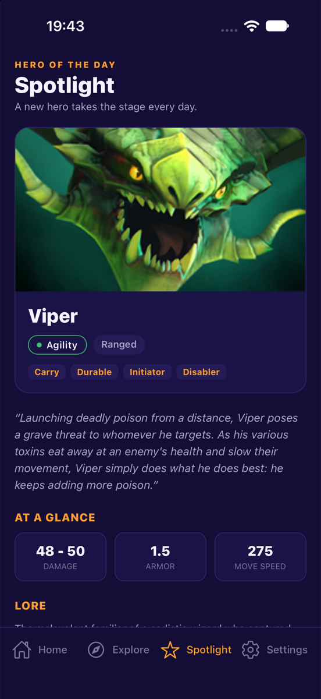
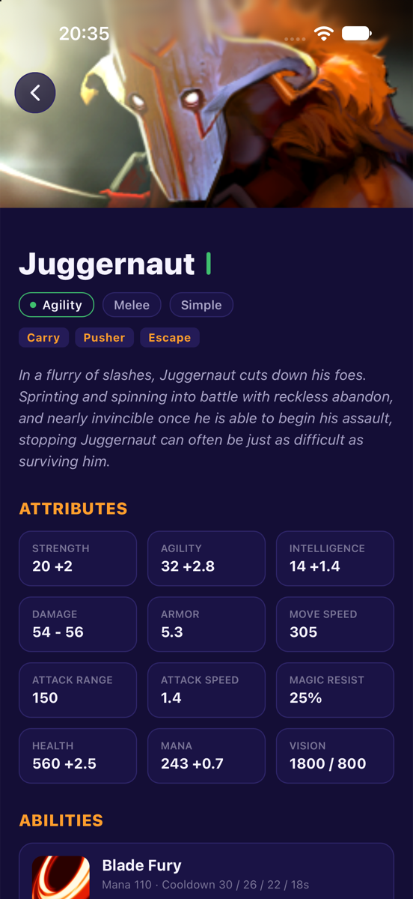
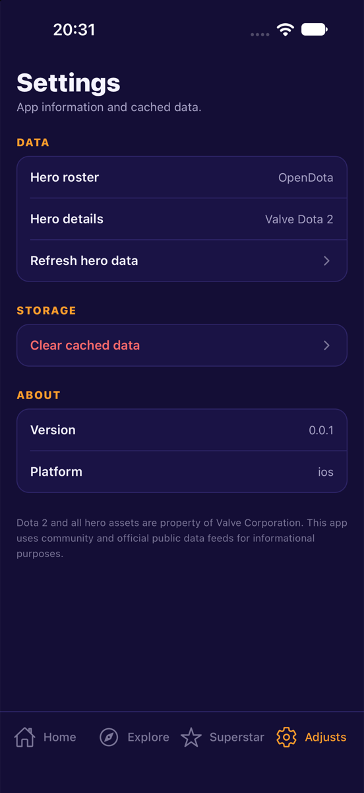

# Dota 2 App

React Native app that lists the 127 Dota 2 heroes from the [OpenDota API](https://docs.opendota.com/) and shows a full hero profile (stats, attributes and abilities) from Valve's Dota 2 data.

## Screens

- **Home** — searchable roster in a two-column grid
- **Explore** — same roster filtered by primary attribute and role
- **Spotlight** — hero of the day with stats, hype quote and lore
- **Hero detail** — attributes, combat stats and abilities with icons
- **Settings** — data sources, cache controls and app info

## Screenshots

Captured on the iPhone 18 Pro simulator (iOS 27). Regenerate them with
`scripts/screenshots.sh` (booted simulator + `yarn ios`); the process is
documented in [docs/screenshots.md](./docs/screenshots.md).

<p>
  
  
  
</p>
<p>
  
  
</p>

## Tech stack

- React Native 0.87 (New Architecture), React 19, TypeScript
- React Navigation 7 (bottom tabs + native stack)
- [TanStack Query](https://tanstack.com/query/latest) for server state
- [InversifyJS](https://inversify.io) + `reflect-metadata` for dependency injection
- [LegendList](https://legendapp.com/open-source/list/) for the heroes lists
- Ionicons (`@react-native-vector-icons/ionicons`), Axios, Jest, ESLint, Prettier

Hero and ability images are loaded from Valve's Steam CDN (`cdn.cloudflare.steamstatic.com`).

## Getting started

Requirements: Node >= 22.11, Yarn 1, JDK 17 + Android SDK (Android), Xcode + CocoaPods (iOS, macOS only).

```sh
yarn install

# iOS
cd ios && bundle install && bundle exec pod install && cd ..
yarn ios

# Android
yarn android
```

`yarn start` runs Metro on its own if you launch the app from Android Studio / Xcode.

## Scripts

| Command | Description |
| --- | --- |
| `yarn start` | Start Metro |
| `yarn android` / `yarn ios` | Build and run on an emulator/simulator or device |
| `yarn test` | Run Jest |
| `yarn lint` | Run ESLint |
| `npx tsc --noEmit` | Type-check |
| `scripts/screenshots.sh` | Recapture the README screenshots on the iOS simulator |

## Architecture

Clean Architecture with an InversifyJS container (`reflect-metadata` + legacy decorators via Babel):

```
src/
  domain/          entities, repository interfaces, use cases (no framework imports)
  data/            DTOs, mappers, data sources, repository implementations
  infrastructure/  HttpClient (axios)
  core/di/         TYPES tokens, ContainerModules, container, DIProvider/useInjection
  core/query/      TanStack Query client (refetch when the app returns to foreground)
  presentation/    screens (Home, Explore, Spotlight, Settings, HeroDetail), navigation, components, hooks, theme
```

Dependencies point inwards: `presentation -> domain <- data -> infrastructure`.

```
HomeScreen -> useHeroes -> useQuery -> GetHeroesUseCase -> HeroRepository -> HeroRemoteDataSource -> HttpClient
HeroDetailScreen -> useHeroDetails -> GetHeroDetailsUseCase -> ...
```

Bindings live in `src/core/di/modules.ts`. Components resolve use cases with `useInjection(TYPES.X)` and call them from TanStack Query hooks; tests can `container.rebind(...)` any dependency with a fake.

### Adding a feature

1. Add the entity, repository interface and use case in `src/domain`.
2. Implement the data source / repository in `src/data` (map API DTOs to entities in `src/data/mappers`).
3. Add tokens in `src/core/di/types.ts` and bind them in `src/core/di/modules.ts`.
4. Expose it to screens through a hook in `src/presentation/hooks` using `useQuery` / `useMutation`.

## Tips

Remove the window shadow from macOS screenshots:

```sh
defaults write com.apple.screencapture disable-shadow -bool TRUE; killall SystemUIServer
```
